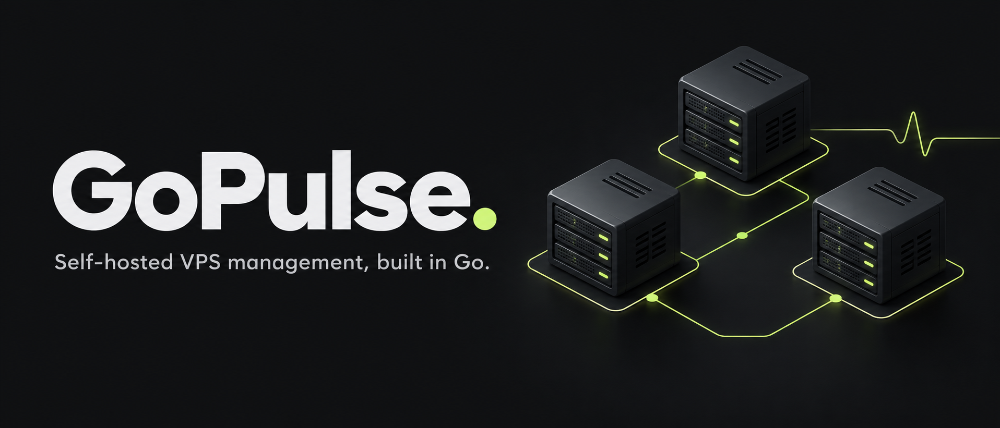

# GoPulse

[](https://github.com/AbdallahAwd/GoPulse/actions/workflows/ci.yml)
[](https://github.com/AbdallahAwd/GoPulse/actions/workflows/release.yml)
[](LICENSE)

**Your servers. Your control.**

A self-hosted control panel for deployments, functions, databases, and monitoring.
Built in Go. Shipped as one binary.



GoPulse brings everyday infrastructure work into one dashboard: connect a Linux
server, deploy an application, inspect its logs, schedule a function, or configure
an encrypted remote backup. You operate the control plane and the servers it manages.

[Get started](#quick-start) · [Documentation](#documentation) · [Releases](https://github.com/AbdallahAwd/GoPulse/releases) · [Contribute](CONTRIBUTING.md) · [Roadmap](ROADMAP.md)

**Status:** early development. Linux is the deployment target; macOS supports
development. The first evaluation prerelease is `v0.1.0-alpha.1`; see
[GitHub Releases](https://github.com/AbdallahAwd/GoPulse/releases) for Linux downloads.
The [readiness report](docs/open-source-readiness.md)
tracks historical credential remediation and verification limits. This project
does not yet carry a production-readiness or availability guarantee.

## What you can do

| Workflow | Included capabilities |
| --- | --- |
| Deploy applications | GitHub integration, HMAC-verified webhooks, deployment queue and history, logs |
| Run functions | Python and JavaScript, manual/HTTP/cron triggers, immutable versions, resource-limited containers |
| Manage infrastructure | Docker containers, processes, systemd services, databases, domains/TLS, Nginx load balancers |
| Monitor and respond | Live metrics, 30-day history, server-scoped alerts, incident history, signed webhook retries |
| Back up databases | Encrypted remote backups over SSH/SFTP, schedules, retention, recovery keys, isolated restore tests |
| Connect AI tools | MCP, scoped credentials, structured function results, audit trails and approvals for disruptive operations |

JWT sessions, RBAC and assigned-server scope govern dashboard/API operations.
SSH connections require verified host keys. Templates and local assets are
embedded in the binary; browser libraries currently load from CDNs.

## Documentation

| Guide | Start here for |
| --- | --- |
| [Installation, releases and upgrades](docs/releases.md) | Download verification, version policy, state backups and rollback |
| [Application CI/CD](docs/cicd.md) | GitHub integration and queued deployments |
| [Functions](docs/functions.md) | Runtime setup, HTTP/cron triggers and execution limits |
| [Monitoring](docs/monitoring.md) | History, alert rules and webhook receivers |
| [Remote backups](docs/remote-backups.md) | Encryption, recovery and restore testing |
| [Infrastructure](docs/infrastructure-management.md) | Databases, Qdrant, load balancers and permissions |
| [AI agents](docs/agent-support.md) / [MCP functions](docs/mcp-functions.md) | Client setup, scoped operations and function exposure |
| [Security policy](SECURITY.md) | Deployment boundaries and private vulnerability reporting |

## Tech Stack

- **Backend**: Go (version declared in `go.mod`)
- **Router**: Chi
- **Frontend**: HTML5 + Tailwind CSS + Vanilla JavaScript
- **WebSockets**: Gorilla WebSocket
- **System Metrics**: gopsutil
- **Docker SDK**: Official Docker Engine Go client (`github.com/moby/moby/client`)

## Quick Start

Start on localhost with an empty state directory. GoPulse is an administrative
control plane: complete first-account setup before exposing it to a network.

### Prerequisites

- Go version declared in `go.mod` or newer; use a patched toolchain
- Node.js 22+ (development only, for frontend tests)
- Docker (optional, for container management)
- MongoDB (optional, for database monitoring)
- PostgreSQL (optional, for database monitoring)

### Installation

1. Clone the repository:
```bash
git clone https://github.com/AbdallahAwd/GoPulse.git
cd GoPulse
```

2. Install dependencies:
```bash
make deps
```

3. Build the application:
```bash
make build
```

4. Set a persistent random JWT secret and run the application:
```bash
export GOPULSE_AUTH_JWT_SECRET="$(openssl rand -hex 32)"
export GOPULSE_SERVER_HOST=127.0.0.1
./bin/gopulse
```

Save the secret securely for subsequent starts. Configure trusted SSH fingerprints in `GOPULSE_SSH_KNOWN_HOSTS` before using remote management.

The dashboard will be available at `http://localhost:8080`

Create the first administrator through the registration screen on an empty store. There is no default login. Use HTTPS for remote access. With a separately managed TLS proxy, set `GOPULSE_AUTH_SECURE_COOKIES=true`; configure `GOPULSE_GITHUB_CALLBACK_URL` explicitly when using GitHub OAuth.

### Configuration

Create a `config.yaml` file in the application directory:

```yaml
server:
  host: "127.0.0.1"
  port: 8080
  read_timeout: "15s"
  write_timeout: "15s"
  idle_timeout: "60s"

auth:
  jwt_secret: "" # Set GOPULSE_AUTH_JWT_SECRET instead
  token_duration: "24h"

monitoring:
  poll_interval: "5s"
  enable_websocket: true
  stats_history: 60

docker:
  host: "unix:///var/run/docker.sock"
  version: "1.41"

database:
  mongo_host: "localhost"
  mongo_port: 27017
  postgres_host: "localhost"
  postgres_port: 5432
  mongo_log_path: "/var/log/mongodb/mongod.log"
  postgres_log_path: "/var/log/postgresql/postgresql.log"
```

### Environment Variables

You can also use environment variables (prefix with `GOPULSE_`):

```bash
export GOPULSE_SERVER_PORT=8080
export GOPULSE_AUTH_JWT_SECRET="$(openssl rand -hex 32)"
export GOPULSE_SSH_KNOWN_HOSTS="/path/to/verified_known_hosts"
# Optional isolated state directory:
export GOPULSE_DATA_DIR="/path/to/dashboard-data"
```

See [the infrastructure guide](docs/infrastructure-management.md) for Qdrant setup, load balancer prerequisites, MCP client connection, permissions, migration changes and test evidence. The [initial audit](docs/infrastructure-audit.md) records the defects found before implementation.

## Usage

### API endpoints

Authenticate with the HttpOnly session cookie or `Authorization: Bearer TOKEN`.
Permissions and assigned-server scope apply to API calls. Resource paths use
`/api/servers/{serverID}`; a server ID in an example is a placeholder.

| Method | Endpoint | Purpose |
| --- | --- | --- |
| POST | `/api/auth/register` | Create the first administrator on an empty instance |
| POST | `/api/auth/login` | Authenticate and receive a session/token |
| GET | `/api/servers` | List assigned servers |
| GET | `/api/servers/inventory` | Scoped fleet/resource inventory |
| GET | `/api/servers/{serverID}/processes` | List processes |
| DELETE | `/api/servers/{serverID}/processes/{pid}` | Kill a process |
| POST | `/api/servers/{serverID}/services/{name}/restart` | Restart a service |
| GET | `/api/servers/{serverID}/containers` | List containers |
| GET | `/api/servers/{serverID}/containers/{id}/logs` | Read container logs |
| POST | `/api/servers/{serverID}/containers/{id}/start` | Start a container |
| GET | `/api/servers/{serverID}/databases` | List databases without credentials |
| GET | `/api/servers/{serverID}/databases/{dbID}/credentials` | Read credentials; requires `database:write` |
| GET | `/api/servers/{serverID}/projects` | List applications; secret fields require `projects:write` |
| GET | `/api/servers/{serverID}/projects/{id}/deployments` | Read deployment history |
| POST | `/api/mcp` | MCP transport with scoped tool authorization |
| GET | `/api/export-import/export` | Download sensitive configuration backup; admin only |
| POST | `/api/export-import/import` | Import configuration; admin only |
| POST | `/api/webhooks/github/{projectID}` | Public webhook authenticated with project HMAC |

`cmd/server/main.go` is the authoritative route registry. See [CI/CD](docs/cicd.md),
[agent support](docs/agent-support.md), [cron jobs](docs/cron-jobs.md), and
[infrastructure management](docs/infrastructure-management.md) for feature details.

## Development

### Run in development mode

Create a local secret once, then start the app with hot reload:

```bash
(umask 077; set -C; printf 'GOPULSE_AUTH_JWT_SECRET=%s\n' "$(openssl rand -hex 32)" > .env)
make dev
```

Skip the first command if `.env` already exists. GoPulse loads `.env` from the working directory for `make dev`, `make run`, and direct binary starts. Exported environment variables take precedence. The file is ignored by Git; keep the secret stable across restarts to preserve sessions. Missing or weak secrets still prevent startup.

### Run tests

```bash
make test
make test-ui
make test-race
# Full local gate (format, vet, tests, production build):
make check
```

### Build for production

```bash
make build-prod
```

### Docker deployment

```bash
# Build Docker image
make docker

# Run container
make docker-run
```

The container requires `.env` with a persistent `GOPULSE_AUTH_JWT_SECRET`, stores state in the `gopulse-data` volume, and publishes only on `127.0.0.1:8080`. Use an SSH tunnel for initial setup and HTTPS for remote access. Supply a read-only verified known_hosts file at `/home/gopulse/.ssh/known_hosts` for SSH access. The container runs as UID 10001; bind-mounted state and key files must be readable by that user. This example is for remote host management: metrics describe the container, and local systemd/Nginx administration needs a native Linux installation. Docker socket access requires explicit host permissions and carries host-administrator privileges.

## UI improvement plan

The [core UI user journeys](docs/ui-user-journeys.md) define server onboarding, application deployment, deployment inspection, troubleshooting, and database backup/restore. They describe target interactions, current implementation gaps, and acceptance scenarios for the UI redesign.

The console starts with **Servers** (`/` and `/servers`). Choose a host to open its resource workspace: Overview, Applications, Databases, Domains and TLS, Load balancers, and administrative tools. A server switcher keeps that context explicit. The fleet supports search, workload filters, grid/list layouts, and a workload grouping based on saved applications, databases, and load balancers. These groupings do not imply network connectivity or automatic orchestration. Activity and workspace settings remain secondary destinations. Existing global resource URLs redirect to the relevant server workload filter. Sections use `?view=projects`, `?view=databases`, and other explicit view names so refresh and browser history preserve the screen. Legacy section hashes are accepted. Mobile navigation uses a collapsible drawer and a server-section selector.

## Architecture

```
GoPulse/
├── cmd/server/          # Application entry point
├── internal/
│   ├── config/          # Configuration management
│   ├── middleware/      # HTTP middleware (auth, logging, rate limiting)
│   ├── handlers/        # HTTP request handlers
│   ├── services/        # Business logic layer
│   ├── monitor/         # Background stats collector
│   └── models/          # Data structures
├── web/
│   ├── templates/       # HTML templates
│   └── static/          # CSS and JavaScript
└── Makefile            # Build automation
```

### Key Design Patterns

1. **Embedded Assets**: Frontend bundled into binary using `//go:embed`
2. **Background Workers**: Goroutines for concurrent system monitoring
3. **Thread-safe Caching**: RWMutex for stats cache access
4. **Middleware Chain**: Composable middleware for cross-cutting concerns
5. **Modular Services**: Separation of concerns (handlers → services → stores)

## Performance and security

Live metrics use the collector cache; history uses SQLite minute summaries retained for 30 days. Alerts evaluate collection results and persist state and webhook deliveries. See [monitoring](docs/monitoring.md) for evaluation, recovery, permissions, and receiver setup. Fleet capacity and latency have not been benchmarked; earlier numerical performance claims were not supported by this verification run.

Requests enforce current RBAC and server scope. SSH uses strict known_hosts verification. MCP adds tool schemas, rate limits, audit and human approval for disruptive actions. API traffic has a 600-request/minute IP ceiling and a 240-request/minute user budget; MCP also limits each user to 60 requests/minute.

Read [the infrastructure guide](docs/infrastructure-management.md) before upgrading: a configured JWT secret and verified SSH host keys are required. Previously exposed credentials were removed from branch history, and the owner confirmed rotation and invalidation of the old values. See [SECURITY.md](SECURITY.md) and supply your own environment configuration. Legacy infrastructure credentials and configuration exports remain sensitive and are not encrypted at rest.

## Troubleshooting

### Docker not available
If Docker is not installed or the daemon is not running, Docker features will be disabled. The application will continue to work with other features.

### Permission denied errors
Some operations require elevated privileges:
- Process killing may need appropriate permissions
- Service management requires systemd/root access
- Docker socket access may need user to be in `docker` group

### Database logs not accessible
Grant the service account read access through an appropriate log-reading group or ACL. Avoid making database logs world-readable; they can contain sensitive queries and connection details.

## License

MIT License - see LICENSE file for details

## Contributing

See [CONTRIBUTING.md](CONTRIBUTING.md) for setup, validation, contribution licensing and review expectations. Report vulnerabilities privately using [SECURITY.md](SECURITY.md).

## Support

See [SUPPORT.md](SUPPORT.md) for bug reports, setup questions and security reports.
Contributions follow the [code of conduct](CODE_OF_CONDUCT.md).


### Dashboard request and database checks

Page HTML and embedded JS/CSS are served independently of API quotas. API traffic has a 600-request/minute IP ceiling before authentication and a 240-request/minute budget per signed-in user; login and registration share a separate 10-attempt/minute IP bucket. A rejected API request returns JSON with `Retry-After`. Proxy headers do not change the bucket identity.

The server fleet uses one scoped `/api/servers/inventory` snapshot with local resource counts. Opening database inventory or details does not probe every remote engine. The connection-check button performs an authenticated live probe (`?refresh=true`) with a 15-second deadline; transport failures retain the last known state and report the actual verification error. Copying a complete database URI explicitly requests credentials through a `database:write`-protected, non-cacheable endpoint. Inventory responses continue to omit secrets.

Air watches `.js` and `.css` alongside Go/templates because these assets are embedded in the server binary. Restart the development watcher after changing its configuration. Startup checks existing application runtimes before attempting automatic starts, so healthy PM2 processes are not recreated merely because the dashboard restarts.

## Open-source maintenance

`make security` checks reachable Go vulnerabilities; `make secrets` checks the
publishable working tree and all locally available Git history, including branches
and tags. Findings identify the file and line with credential values redacted.
`make secrets-source` and `make secrets-history` diagnose each scope separately;
neither replaces the combined release gate. Source and retained branch history
scan clean after the 2026-10-18 cleanup. No real credential baseline is used;
the owner confirmed that the old exposed credentials have been invalidated.

CI tests Go and frontend behavior, runs the race detector, builds Linux amd64/arm64
archives with checksums and dependency licenses, and tests container startup.
The [release workflow](https://github.com/AbdallahAwd/GoPulse/blob/main/.github/workflows/release.yml) adds version metadata and
creates a GitHub Release draft after its checks pass. Read the
[release guide](docs/releases.md) before manually starting a release. Dependabot proposes
weekly dependency updates.

The deployment workflow is manual and uses the `production` environment; forks do not deploy on push. Repository owners should enable private vulnerability reporting and secret scanning where available, protect the default branch with required CI checks, and configure environment reviewers before enabling deployment.

The MIT license covers GoPulse's original source. Redistributed Go dependencies and remotely loaded frontend libraries retain their own licenses; see [THIRD_PARTY_NOTICES.md](THIRD_PARTY_NOTICES.md).
