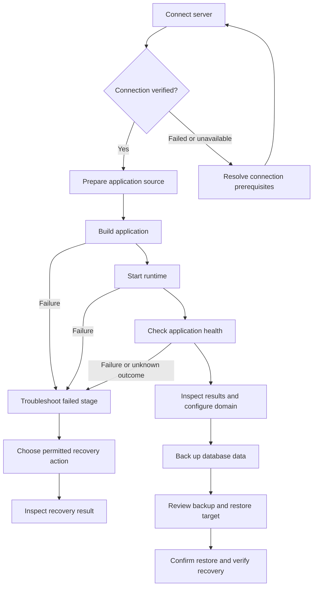

# GoPulse core UI user journeys

Step 1 of the UI improvement plan defines the tasks that navigation and screen design must support. GoPulse should help a trusted team connect its infrastructure, deploy applications, understand results, troubleshoot failures, and recover database data. Every journey ends with evidence of its outcome and a clear next action.

The target behavior below is a design specification. The current UI paths and implementation gaps describe the working tree reviewed on 13 October 2026; they do not mean the proposed behavior is already implemented.

## Users and scope

| User | Primary need | Access boundary |
| --- | --- | --- |
| Administrator | Connect servers, configure team access, deploy and recover resources. | Administrator access; always show the target server and resource before a consequential action. |
| Operator | Deploy, inspect, troubleshoot, and back up assigned resources. | Explicit action permissions and allowed servers. The role name alone does not authorize a write. |
| Viewer | Understand resource state and deployment results. | Existing server scope and read authorization. Present unavailable write actions with a reason. |

Assume the team supplies its own VPS machines, DNS, and SSH credentials. The journeys must work on desktop and mobile. Resource creation, source transfer, runtime start, application health, and public reachability are separate outcomes.

This step covers five journeys. Final navigation, visual components, and screen implementation follow in later steps. Customer billing, automatic scaling, fleet provisioning, and automatic database failover are outside this scope.

## Journey overview

| Journey | Current entry point | User decisions | Required outcome | Next action |
| --- | --- | --- | --- | --- |
| Connect a server | Servers → Connect Server | Target host, SSH user, authentication, credentials, and optional SSH port. | Inventory saved; connection verification reported separately with its check time or unavailable state. | Deploy an application, manage databases, or resolve connection prerequisites. |
| Deploy an application | Servers → selected server → Applications → New application | Source, technology, configuration, target server, environment, and whether to build/start. | Source preparation, build, runtime start, and application verification have distinct results. | Inspect the application, configure its domain, or troubleshoot the failed stage. |
| Inspect a deployment | Project → Operations → Releases | Application, deployment attempt, and whether to inspect logs/health. | Identity, revision, trigger, timestamps, status, and available evidence are visible for the selected attempt. | Open runtime logs, run a health check, or deliberately request another deployment. |
| Troubleshoot a failure | Project → Operations → Releases, Logs, or Health | Failed attempt, diagnostic scope, configuration change, and permitted recovery action. | The user understands the affected resource, last confirmed state, and next safe action. | Recheck health or inspect the recovery attempt. |
| Back up or restore database data | Server dashboard → Databases → database detail → Backups | Database, backup file, retention, or destructive restore target. | Backup location and evidence are clear; restore results distinguish command completion from verified recovery. | Download/copy the backup or verify the restored database and application. |

The backup journey can also begin directly from an existing database; it does not require a new application deployment.

## Connect a server

**Entry:** The server inventory, including its empty state. The primary action is **Connect Server**. Require `server:write` or administrator access.

| Stage | User interaction | Feedback and recovery |
| --- | --- | --- |
| Identify target | Enter display name, hostname/IP, SSH user, and authentication method. Default the SSH port to 22; expose a nonstandard port under Advanced. | Validate required fields beside their inputs. Preserve nonsensitive values after an error. |
| Supply credentials | Upload a private key or enter a password. Explain the trusted host-key prerequisite and where it is configured. | Mask secrets. An upload error stays beside the credential field. Never suggest bypassing host verification. |
| Review and save | Show host, port, user, and authentication method without credential contents. Submit once. | Distinguish saving the inventory record from making an SSH connection. Prevent duplicate submissions while pending. |
| Report verification | Show verified, failed, or verification unavailable, together with the actual check time when available. | Identify DNS/network, authentication, or host-trust failures only when the returned evidence supports that classification. Otherwise show a useful generic failure and diagnostic details. |
| Continue | Open the saved server and choose application or database management. | A failed check offers Edit settings and Recheck when supported. Save credentials again only when required; do not repopulate secrets from a response. |

**Success:** A saved server has an explicit connection result. A saved record alone must never show **Connected** or **Online**.

**Current gap:** `AddServer` saves inventory without checking SSH. The current success notification says the server connected, and inventory cards render Online unconditionally. There is no dedicated connection-verification response in this flow. Until verification exists, use **Server saved · Connection not verified** rather than fabricating a successful check.

## Deploy an application

**Entry:** Today, the selected server's Projects view. Later navigation must make applications discoverable without requiring users to understand Processes or Docker. Require `projects:write` and access to the actual target server.

| Stage | User interaction | Feedback and recovery |
| --- | --- | --- |
| Choose source | Select GitHub repository or ZIP upload. Keep the selected server visible. | Explain GitHub authorization when needed. A cancelled repository selection or failed upload preserves the rest of the form. |
| Choose runtime | Select a supported technology and execution mode. Use detection only when a supported response actually provides it. | Offer relevant defaults and explain uncertain detection. Do not silently choose a different technology. |
| Configure | Enter application name, port, build/start commands, environment, and restart preference. Put optional technical settings under Advanced. | Validate required values before submission. Explain whether configuration changes require a rebuild or restart. |
| Review | Summarize source, server, runtime, port, and planned actions. Mask environment values. | Separate **Create application** from **Build** and **Start** until a combined operation is supported. Show what will happen before the action begins. |
| Prepare source | Create the resource and clone or upload its code. | Report source preparation separately. If a resource was created before transfer failed, retain its identity and offer recovery on that resource rather than creating a duplicate. |
| Build and start | Request the build and then runtime start, retaining their individual outcomes. | Name the current stage and failed stage. Prevent conflicting actions while work is pending. Warn that existing redeployment can interrupt the application. |
| Verify and continue | Inspect available health diagnostics. Offer application details and domain setup. | A running process/container does not prove application health or public reachability. Show **Health not verified** if there is no check. Domain/TLS setup remains a separate action. |

**Success:** Source, build, and runtime results are explicit. **Application verified** requires a recorded successful application check. **Publicly reachable** requires separate evidence for the configured address.

**Current gaps:** Creating or cloning a project does not build/start it in the creation flow. The current form displays all three numbered sections at once. Initial creation/build/start actions do not share the durable deployment history used by Git redeployments. Repository imports default to process execution. These differences must remain visible until implementation unifies them.

## Inspect a deployment

**Entry:** Today, Project → Operations → Releases. A user can also enter after requesting a Git redeployment. Inspection requires resource read access; submitting another deployment requires write permission.

1. Identify the application and server before selecting an attempt.
2. Display the attempt's source, requested revision, delivery identity when useful, queued/start/finish timestamps, and status.
3. Explain `queued`, `running`, `succeeded`, and `failed` without merging them into the application's runtime state.
4. Display the recorded error and available diagnostics. Clearly label current runtime logs; they are not necessarily historical logs from the selected attempt.
5. Offer Refresh, runtime logs, and Health. Offer another deployment only to an authorized user, with its target and source explicit.

**Success:** The user can tell which revision was attempted, what the backend reported, and what remains unverified. A `202` response means accepted/queued, not deployed. Backend `succeeded` currently indicates deployment commands completed; it does not establish application readiness.

**Recovery:** If loading history fails, retain the selected resource and show Retry. If the session expires, request sign-in and preserve only nonsensitive navigation context. After an interrupted connection, fetch the accepted attempt before offering another submission. Queued deployments resume after a control-plane restart; previously running attempts are marked failed rather than blindly replayed.

**Current gaps:** Git redeployments have durable records and polling in the Releases dialog, but initial/manual build/start flows do not. Runtime logs are retrieved separately from deployment history. Persistent build-stage logs and application verification associated with each attempt are future capabilities.

## Troubleshoot a failure

**Entry:** A failed deployment result or the application's Logs/Health views. Start with read-only diagnostics; present writes only when the user has the corresponding permission.

| Failure category | Show first | Recovery choice |
| --- | --- | --- |
| Source preparation | Repository/upload error and selected source. | Restore GitHub access or correct the source; retry against any already-created resource. |
| Build | Recorded error and configured build command. | Correct code/configuration and deliberately request another build/deployment. Do not claim the previous application remains healthy without checking it. |
| Runtime start | Start command, last reported state, and available runtime logs. | Correct environment/command/port, then request a permitted start or new deployment. |
| Application health | Check time, probe result, and configured endpoint. | Investigate application dependencies and runtime logs; restart only after reviewing its effect. |
| Server connection | Last successful observation and available connection error. | Recheck connectivity or edit server settings; keep stale observations visibly marked. |
| Unknown write outcome | Accepted attempt/operation identity when available and last confirmed state. | Reconcile current state before repeating a write. A timeout does not establish that the remote command failed. |

**Success:** The user knows the failed stage, the available evidence, and the exact resource affected. A recovery action ends with a fresh result; a green notification alone does not establish recovery.

Keep the application, server, selected attempt, and entered nonsensitive configuration in context. Raw terminal access is an advanced fallback with its own authorization, not the first troubleshooting instruction. No automatic restart, deletion, rollback, or retry should be inferred from opening a diagnostic view.

## Back up and restore database data

**Entry:** The selected database's Backups view. Use `database:write` and actual server/resource ownership for backup creation, scheduling, and restore actions. Read/download controls follow their existing authorization.

### Create and inspect a backup

1. Show database name, engine, and server before requesting a backup.
2. Explain the backup's destination and coverage. Existing dump archives stay on the database VPS; configuration export is not a database data backup.
3. Report generation in progress and prevent duplicate submission. When finished, show filename, creation time, size, and storage location.
4. Describe the evidence precisely: an archive created by a command is **Created**, not **Restore verified**. Show verification as unavailable until an actual restore test exists.
5. Offer download and retention settings where supported. Explain that a local archive shares the server's failure domain.

**Recovery:** Preserve existing backup entries if refresh or backup creation fails. A failed list request must show a loading error rather than **No backups**. A timed-out backup has an unknown outcome until the list/result is reconciled.

### Restore a backup

1. Select a compatible backup and inspect its timestamp, size, database, and location.
2. Show the target server/database and the overwrite consequences. Preserve a current backup first when supported, or explain why that protection is unavailable.
3. Require explicit confirmation of the target database for destructive restore. Preserve data by default in adjacent remove-service workflows.
4. Report restore progress, command outcome, and any required next checks separately. Do not allow a second restore while the first outcome is unresolved.
5. Recheck database health and confirm representative application data before presenting **Recovery verified**.

**Recovery:** A restore failure keeps the target and selected file visible with diagnostic details. Because data may already have changed, do not offer a blind retry. Reconcile database state and choose a new recovery action explicitly.

**Current gaps:** Existing database restores rely on browser confirmation and request/toast feedback. Backup listing treats some failures like an empty inventory. Durable backup/restore progress, offsite storage, and verified recovery are not provided consistently. Qdrant has a separate snapshot/operation workflow; its files and restore actions must retain their engine-specific semantics.

## Shared interaction contract

| Situation | Required behavior |
| --- | --- |
| Empty inventory | Explain the missing resource and offer the first permitted creation action. |
| Empty filtered results | Offer Clear filters; do not imply the resource inventory is empty. |
| Validation error | Place the explanation beside the field, move focus to the first error, and retain the form. |
| Request pending | Label the actual stage, disable duplicate submission, and distinguish closing the view from cancelling work. |
| Accepted long operation | Retain its identity and provide a route back to progress when supported. |
| Permission denied | Name the needed capability without exposing hidden resources; offer a team administrator as the next contact. |
| Expired session | Preserve nonsensitive destination context; do not persist credentials or automatically repeat writes after sign-in. |
| Failed read | Keep prior data visibly stale with a check time; provide Retry. |
| Failed or uncertain write | Keep the target and last confirmed state; reconcile before retrying. |
| Destructive action | Name the resource/server, consequences, and data-retention behavior before confirmation. |
| Dialog or drawer | Provide accessible labels, initial focus, focus containment/restoration, and keyboard dismissal where safe. Warn before discarding entered changes. |
| Mobile layout | Keep the current task visible; navigation must collapse rather than occupy the entire first screen. |

## Completion checks for later UI implementation

These are acceptance scenarios for the screen changes that follow. Document completion does not imply the application passes them today.

| Scenario | Pass condition |
| --- | --- |
| New administrator connects a server | Distinguishes inventory save from connection verification and finds application/database management next. |
| Wrong or untrusted SSH target | Receives an actionable failure without a false Online badge or recommendation to bypass trust checks. |
| Git and ZIP application creation | Understands which source actions completed and whether build/start still need to be requested. |
| Partial source-transfer failure | Can recover the existing resource without unknowingly creating a duplicate. |
| Failed build or start | Identifies the failed stage and retains configuration and target context. |
| Accepted Git deployment | Finds the same persisted attempt after closing/reopening its view; does not interpret acceptance as success. |
| Runtime starts but application is unhealthy | Sees separate runtime and application-check results. |
| Network loss during a write | Reconciles the accepted operation or current state before resubmitting. |
| Read-only user | Can inspect permitted resources while write controls explain unavailable capabilities. |
| Backup list failure | Sees an error/retry state rather than an empty-backup message. |
| Destructive restore | Reviews the exact target and overwrite consequences; command completion and verified recovery remain distinct. |
| Keyboard and narrow viewport | Completes navigation/form review without inaccessible technology selectors, background focus, or an obstructing full-screen menu. |

## Implementation references

| Journey | Current implementation |
| --- | --- |
| Server onboarding | [Server inventory UI](../web/templates/server_list.html), [server handlers](../internal/handlers/server_handler.go), [SSH trust and execution](../internal/remote/ssh_client.go). |
| Application creation and runtime | [Project UI](../web/static/js/app/projects.js), [project handlers](../internal/handlers/project_handler.go), [GitHub handlers](../internal/handlers/github_handler.go), [project service](../internal/services/project_service.go). |
| Deployment inspection and recovery | [CI/CD guide](cicd.md), [deployment manager](../internal/services/deployment_manager.go), [deployment store](../internal/store/deployment_store.go). |
| Database backup and restore | [Database UI](../web/static/js/app/databases.js), [database service](../internal/services/database_service.go), [backup scheduler](../internal/services/backup_scheduler.go), [Qdrant snapshot workflow](../web/static/js/app/infrastructure.js). |
| Permissions and shared feedback | [Permission guard](../internal/middleware/access.go), [authentication](../internal/middleware/auth.go), [shared UI feedback](../web/static/js/app/core.js), [shared operation tracking](../web/static/js/app/infrastructure.js). |

Step 2 uses these journeys to define navigation and screen ownership. Keep the existing Go templates and JavaScript while changing the interaction model. Any screen that requires a missing backend capability must identify that dependency and display the available evidence honestly.

## Navigation direction after Step 2 review

The console starts with the servers the user manages. Choose a server before managing its applications, databases, load balancers, domains, or administrative tools. A selected-server sidebar and server switcher keep host context explicit. Activity and workspace settings are secondary screens.

The fleet offers grid/list layouts, search, workload filters, and a workload grouping. Groups come from saved applications, databases, load balancers, and the existing database-focus setting. A host can appear in multiple groups. Missing counts stay unknown. Grouping does not create a cluster, configure network links, provision replication, or imply live server health; distributed-system operations need their own explicit implementation and feedback.
